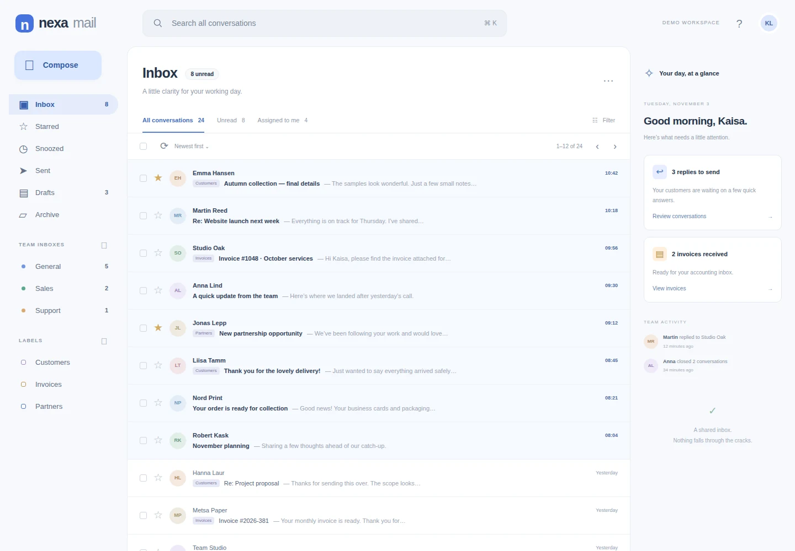

# Nexa Email Inbox

A calm, Gmail-inspired shared inbox starter: conversations, search, starred messages, team folders, and a daily overview. Original Nexa interface; no Google assets or services are included.

[Live preview](https://nexaintel2.github.io/email-inbox/) · [Use with Nexa](https://admin.nexaintel.work)



This is a **visual template with fictional sample data**, not a working email service. Search, filters, stars, and selection work locally. Other controls explain that they are previews. Nothing is sent or stored, and there is no backend, authentication, analytics, or external asset dependency.

## Run and build

Use Node.js 22 or newer. No dependency installation is needed.

```sh
npm run dev          # http://localhost:3000; PORT overrides the port
npm run build        # static site in dist/
```

Edit `index.html`, `styles.css`, and `app.js`. The sample conversations live in `app.js`. All styling and assets are local. GitHub Pages serves the main branch from the repository root.

## Make it yours

Choose **Use template** in Nexa, or import `https://github.com/nexaintel2/email-inbox.git` as a new project. Preserve the upstream Git history for future updates. Configure a unique Worker name in `wrangler.jsonc`, run the build, and deploy `dist/` through the project's Cloudflare connection. The config includes no account IDs, secrets, or bindings.

Before using real email, implement provider authorization, mailbox sync, sending, attachments, access control, persistence, and retry handling. Replace sample contacts and counters with actual data. There are no database migrations or integrations yet.

## Releases

- **0.1.0** — Responsive inbox preview, local search and filters, static build, and Cloudflare assets configuration.

MIT licensed. See `LICENSE`.
